<div align="center">

# 地形制图台 · Terrain Atelier

**选一个省 / 市 / 县，把这块地立起来，做成一件可以裱框的地图。**

真实 90m DEM · 12 种制图风格 · 8 种画框 · 框内经纬网 · 轨迹飞行 · 零构建

<br>

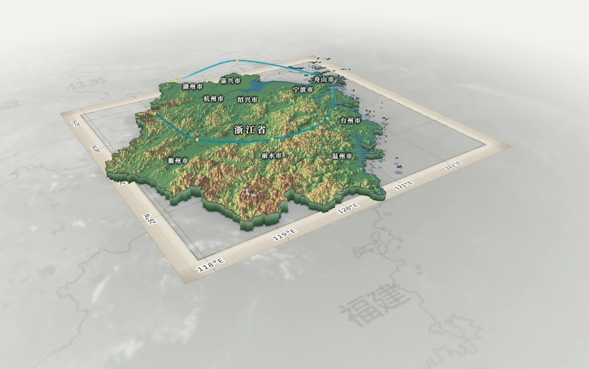

<br>


</div>

---

## 这是什么

一个**浏览器里的三维地形制图工具**。打开页面，选一个行政区，它会拉取该区域真实的高程瓦片与行政边界，
把这块地按真实起伏立起来，再让你决定它长什么样：用哪种制图语言、太阳从哪个方向照、
要不要河湖、要不要画框、框里要不要经纬网。

它不做"地理分析"，解决的是**这段地形怎么讲得好看**：

- **不是噪声山**：每一条山脊都来自真实 DEM，落差、坡向、河谷位置都对得上；
- **不是截图工具**：山体、水、云、画框都是实时渲染的，改一个滑块画面立刻变；
- **不是要装一堆东西的工程**：没有 `npm install`，没有打包步骤，`git clone` 完起一个 Python 静态服务就能跑；
- **不是只能看**：隐藏界面（快捷键 `H`）就是一张可以直接交出去的图。

---

## 界面速览

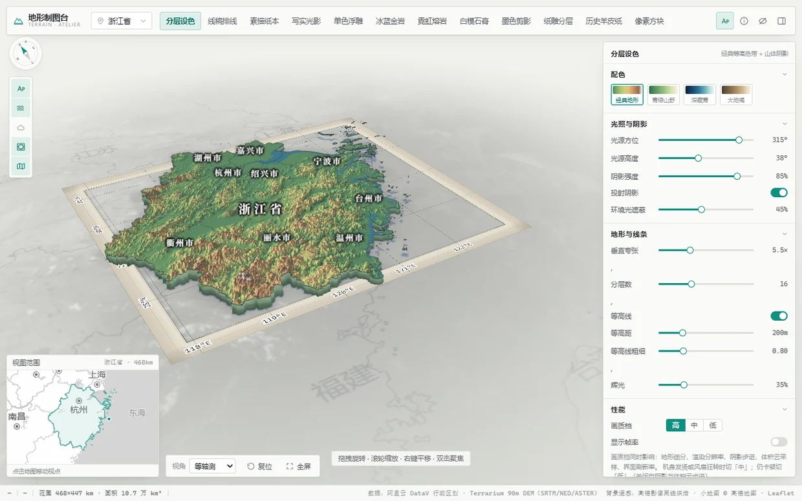

| 区域 | 内容 |
| --- | --- |
| **顶栏** | 区域选择（省 / 市 / 县）、12 种风格切换、名称标注开关、隐藏界面（`H`）、收起面板 |
| **左栏** | 图层总开关竖排图标：名称标注、水面、云层、画框、背景底图 |
| **画布** | 三维地形；拖拽旋转、滚轮缩放、右键平移、双击聚焦 |
| **右侧面板** | 配色、光照与阴影、地形与线条、性能、图层、动画与轨迹、底板与输出 |
| **左下 / 底部** | 视角预设、复位、全屏；小地图（随视角联动）、比例尺、投影、经纬度、在线状态 |

左栏图标与右侧面板里的分组开关是**同一状态的两个入口**，点哪边两边都会同步；
分组关掉后组内参数整块置灰且不接收点击 —— 不会出现"拖了滑块没反应"这种分不清是坏了还是没开的情况。

---

## 12 种制图风格

同一块地、同一个机位，只换渲染风格：

<table>
<tr>
<td align="center" width="33%">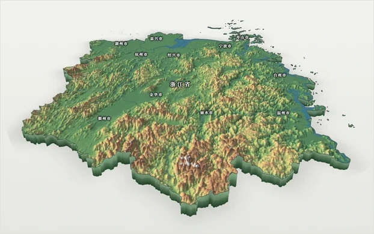<br><b>分层设色</b><br><sub>经典等高色带 + 山体阴影</sub></td>
<td align="center" width="33%">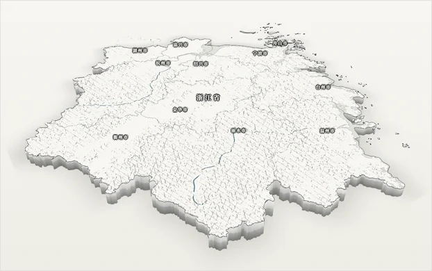<br><b>线稿排线</b><br><sub>墨线 + 网点 + 坡向排线</sub></td>
<td align="center" width="33%">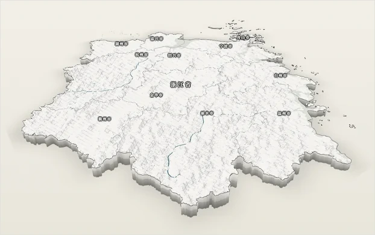<br><b>素描纸本</b><br><sub>铅笔交叉排线 + 纸纹</sub></td>
</tr>
<tr>
<td align="center">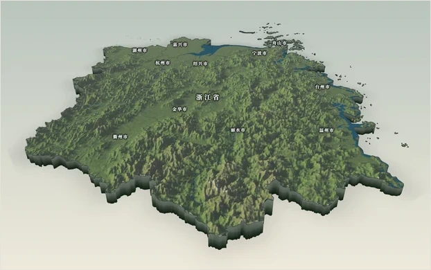<br><b>写实光影</b><br><sub>植被 / 岩壁 / 雪线 + 大气雾</sub></td>
<td align="center">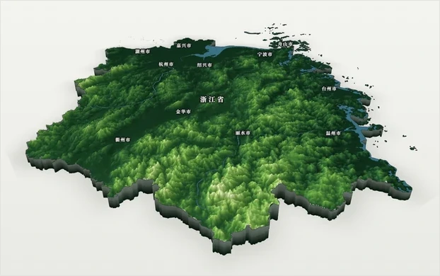<br><b>单色浮雕</b><br><sub>单一色相 + 强顺光</sub></td>
<td align="center">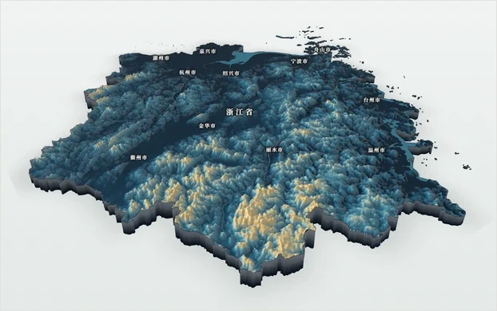<br><b>冰蓝金岩</b><br><sub>冷调岩体 + 高处金棕</sub></td>
</tr>
<tr>
<td align="center">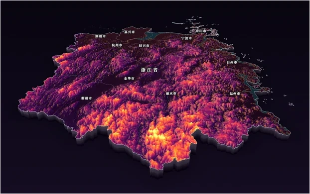<br><b>霓虹熔岩</b><br><sub>高饱和发光 + 裂隙</sub></td>
<td align="center">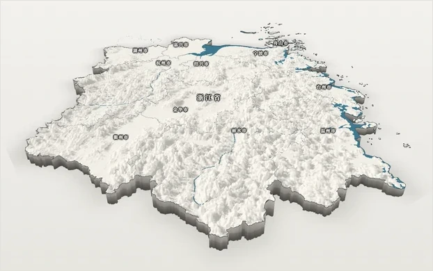<br><b>白模石膏</b><br><sub>无彩色模型 + 长投影</sub></td>
<td align="center">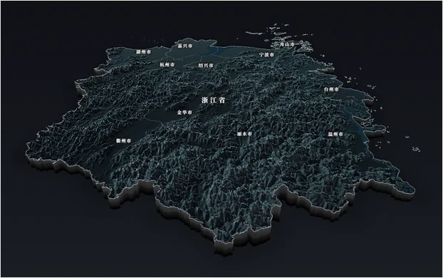<br><b>墨色剪影</b><br><sub>深色实体 + 边缘光</sub></td>
</tr>
<tr>
<td align="center">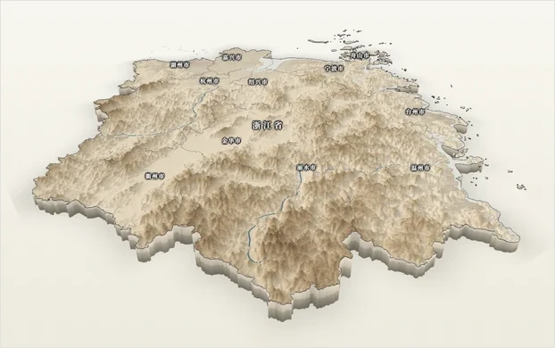<br><b>纸雕分层</b><br><sub>等高分层 + 层间切边阴影</sub></td>
<td align="center">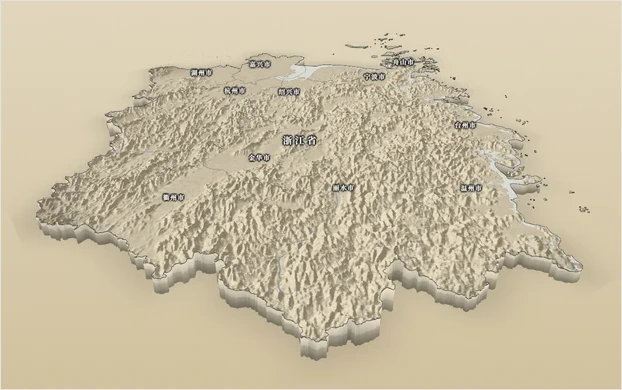<br><b>历史羊皮纸</b><br><sub>做旧纸底 + 棕褐晕渲</sub></td>
<td align="center">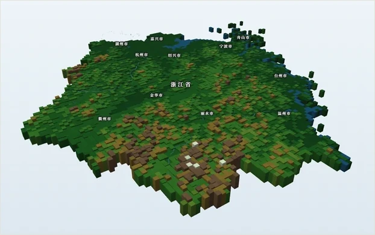<br><b>像素方块</b><br><sub>体素柱体 + 三档块面明暗</sub></td>
</tr>
</table>

每种风格都带 **3~4 套配色**，切换配色只换色带、不动几何，所以是瞬时的。
像素风格还能调「方块尺寸」，从 48 格到 240 格 —— 格子越少越像积木，越多越接近地形模型。

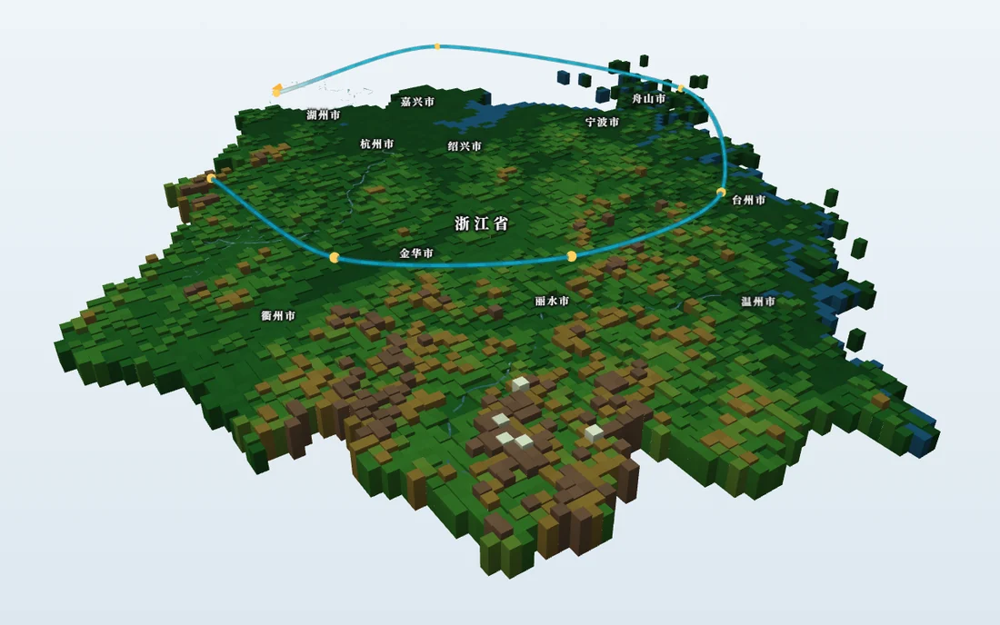

---

## 画框：把地图做成能裱起来的东西

画框以**行政区四至**为内边界，向外让出「内留白 + 框带」，画在模型底座所在的平面上，
所以它是真正跟着地形走的，不是后期贴的一张图。经纬网、刻度、经纬度数字都画在框带与框板上，
**不贴在山体表面挡地形**。

<table>
<tr>
<td align="center" width="50%">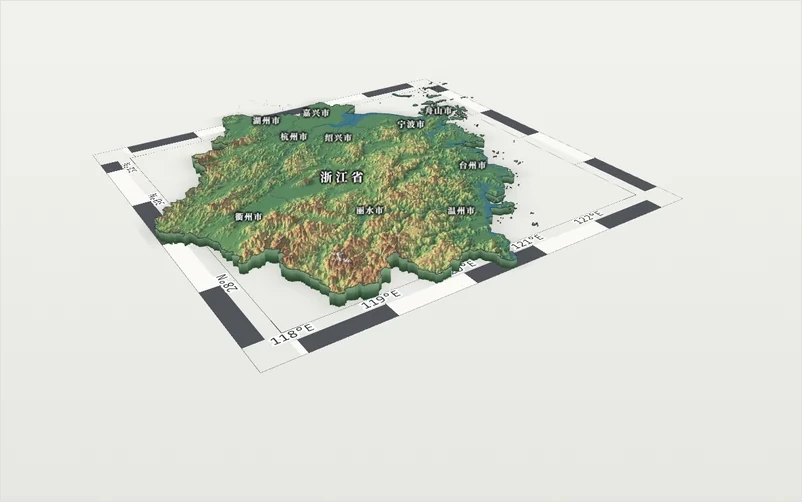<br><b>分格框</b><br><sub>黑白相间的经纬度分格带（USGS 图廓风格）</sub></td>
<td align="center" width="50%">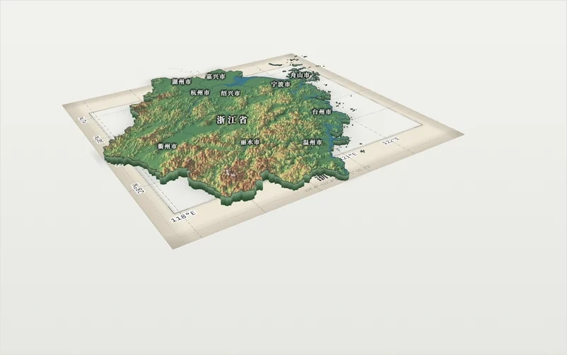<br><b>铭牌框</b><br><sub>上下加宽「天头地脚」，下侧放区域名与经纬范围</sub></td>
</tr>
<tr>
<td align="center">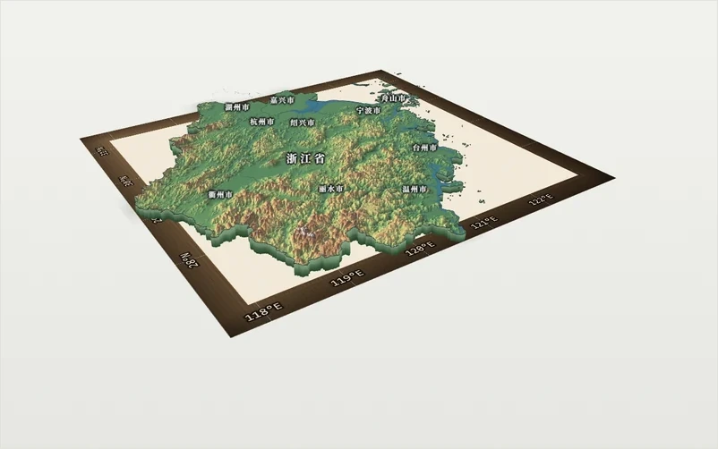<br><b>木框</b><br><sub>深棕木料 + 内金线 + 外沿高光，内圈铺卡纸</sub></td>
<td align="center">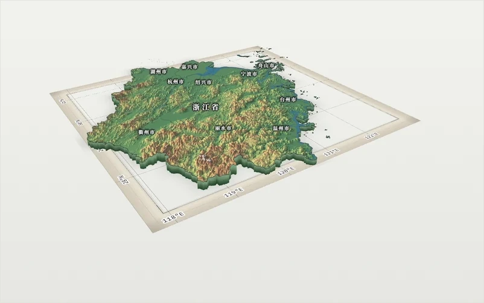<br><b>裱框</b><br><sub>卡纸底 + 内双线 + 金色卡纸中线 + 厚度内阴影</sub></td>
</tr>
</table>

| 框体 | 说明 |
| --- | --- |
| 细线 | 四至一条细线 + 外缘细线，最轻 |
| 双线 | 内粗外细，书刊图廓感 |
| 图廓 | 经典地图图廓：内细 + 中细 + 外粗三道线 |
| 分格 | 黑白相间的经纬度分格带（USGS 图廓），最「专业制图」 |
| 裱框 | 卡纸底 + 内双线 + 金色卡纸中线 + 厚度内阴影 |
| 倒角 | 四边斜面渐变，有受光方向 |
| 铭牌 | 上下对称加宽「天头 / 地脚」，下侧放区域名与经纬范围 |
| 木框 | 深棕木料 + 内金线 + 外沿高光 |

可调参数：**框带色**（跟风格 / 纸白 / 米黄 / 石灰 / 墨黑 / 藏青，木框固定木料色）、
**框宽** 2%~14%、**内留白** 0~6%、**线宽** 0.5~2.5×、**角饰**（无 / L 角 / 方块 / 圆点）、
**经纬网间隔**（自动 / 2° / 1° / 30′ / 15′ / 6′）、**网格浓度**、**标题铭牌**（仅铭牌框）。

### 正俯视出图档

把视角压到正上方、背景切成素色，就是一张规规矩矩的平面制图：

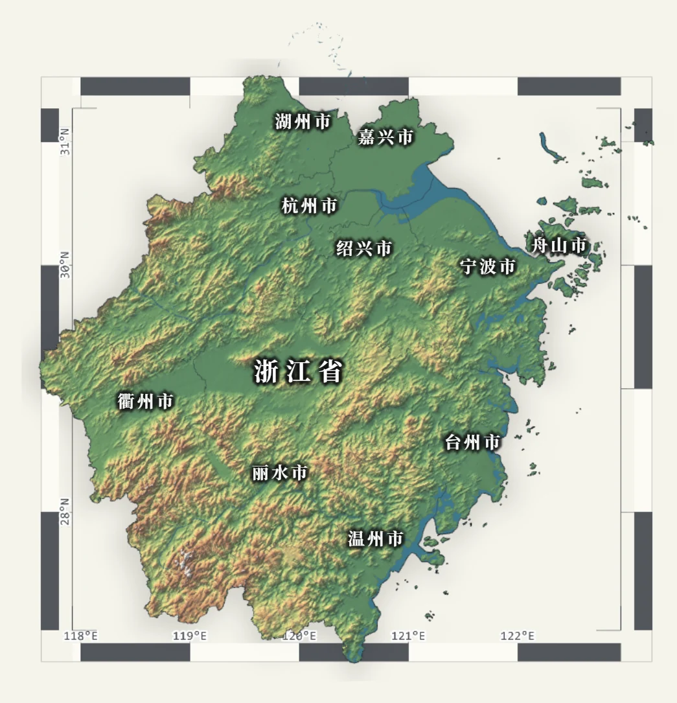

---

## 真实地形，真实光影

- **数据**：AWS Terrarium 90m DEM，按当前区域范围自动抓取并解码成高程网格；
- **取景**：按区域四至的**主连通块**算包围盒（海南那种带三沙离岛的省不会把镜头拉爆），
  再按当前视口把透视投影的实际画面居中、缩放；
- **垂直夸张** 1×~15×，分层数 4~40 级，等高距 20~800m 可调；
- **光照**：太阳方位 0~360°、高度角 3~88°、投射阴影、环境光遮蔽（AO）；
- **材质**：纸纹颗粒、大气雾、辉光、边缘光、雪线、底座厚度，按风格显示不同的可用项。

山体自阴影是**屏幕空间光线步进**（raymarch），不是贴图假阴影：
山脊会把阴影投到对面的谷地里，太阳压低时影子会拉长 —— 这一步是"立体感"的关键。

---

## 图层

| 图层 | 能力 |
| --- | --- |
| **名称标注** | 四套字样（宋体描边 / 楷体书法 / 黑体细排 / 标签牌）、字号、字距、字重、文字色、描边开关与粗细/颜色/浓度、离地高度、同屏最多显示数、居中或贴地 |
| **水面（河湖）** | 内置 Natural Earth 河湖；也可以上传自己的 GeoJSON（WGS84，面＝湖、线＝河）。水面高度自动跟随垂直夸张 |
| **云层** | 体积云（逐像素 raymarch，有厚度、云底暗云顶亮）与平面云（几张半透明云图，几乎不耗性能）一键切换；体积云可在地形上单击放云、随机撒云、清空 |
| **背景底图** | 离线烘焙的遥感影像，随风格自动变色、浓度可调 |
| **离岛与飞地** | 远离主体的岛礁（三沙、沿海离岛）面积小于一个 DEM 格子、取不出地形，但**边界照画**；可一键切「含离岛」正俯视全图 |
| **画框与经纬网** | 见上一节 |

标注不是贴图，是**按经纬度投影到屏幕空间的 DOM 层**：字号、字距、描边、颜色全部是 CSS 控制，
所以任何分辨率下都是清晰的矢量字，还能保持可读性（压在山脊上会被描边托出来）。

### 离岛与飞地：没有 DEM，也要有边界

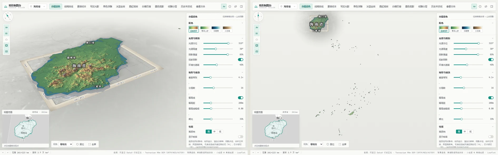

海南是最难处理的一个：省级轮廓里有 **109 个面**，除了海南岛本岛，其余 108 个是散在南海的岛礁，
最南到 3.83°N —— 离本岛 1700 km。

这类面有两个互相冲突的要求：

- **不能算进主图包围盒**。把三沙算进去，海南的范围会从 261×223 km 涨到 972×1806 km，
  DEM 只能落到低层级瓦片，本岛缩成一个小点；
- **但也不能丢**。要的是"行政区边界"，不是"有地形的那部分"。

所以现在把两件事拆开：

| | 参与取景 / DEM | 渲染方式 |
| --- | --- | --- |
| **主图**（海南岛等） | 是 | 完整地形：高度场 + 侧壁 + 轮廓线 |
| **离岛 / 飞地**（三沙岛礁等） | 否 | 零高程薄色块 + 闭合轮廓线，贴在地图平面上 |

几个细节：

- 主图 padding 从 0.55 收到 **0.30**。原来的值会把 175 km 外的 5 块西沙礁盘也算进主体，
  海南范围被撑到 397×399 km，本岛只占左上角一小块；收紧后只丢掉"远"，不影响任何近岸群岛
  （浙江 156 个岛、福建 73 个岛、辽宁 34 个岛全部保留）；
- 下级行政界线改为按**全域**包围盒采集，不再用主图范围 —— 海南视图里三沙的 112 条区划边界现在一条不少；
- 离岛全部合并成 **2 个 draw call**（1 个填充 + 1 个线段），108 个岛礁几乎不增加开销；
- 面板「图层 → 离岛与飞地」可以关掉它，或把取景切到「**含离岛**」。跨度 1800 km 时斜俯视会把
  南端岛礁甩到相机背后，所以这一档直接走**正俯视全图**。

---

## 轨迹飞行

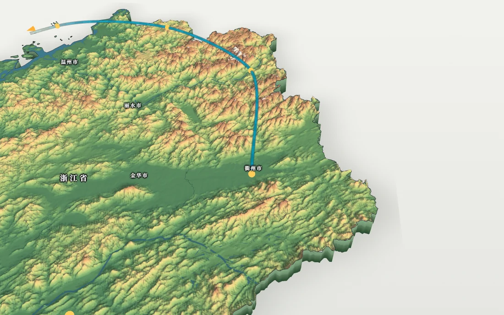

- **绘制**：「绘制轨迹」在地形上点节点；或「示例轨迹」一键生成一条环线；
- **航线是水平面**：所有节点走同一个高度，不再逐点贴合地面起伏。拖动「巡航高度」**只改一个数**，
  不重建任何几何体，所以能实时跟手；拖动范围 1.2%~26%（相对区域跨度），并且会自动抬到地形最高点之上；
- **飞行中视角是活的**：相机跟着飞行器走，但鼠标左键拖动仍可绕它旋转、滚轮可调远近，不被固定机位锁死；
- **可见性联动**：关掉「显示轨迹线」时，前端的箭头也会一起隐藏。

---

## 行政区选择

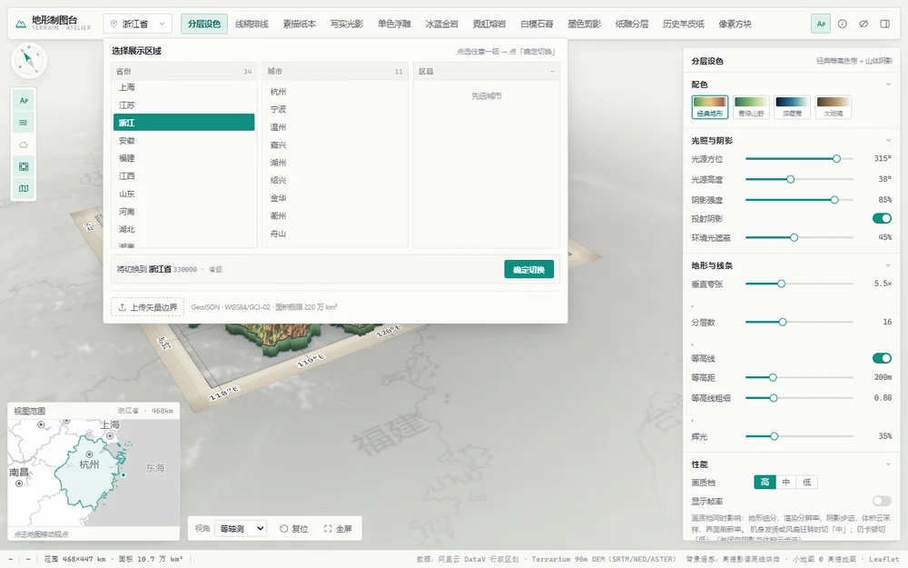

- 省 / 市 / 县**三列并排**，点任意一列只是「选中」，同一次操作里可以一路点到县；
- 最后点 **确定切换** 才载入一次 —— 不会每点一下就重新下载、重新生成；
- 左列当前底图所在的省 / 市带一道细竖条提示；双击任一列条目 = 选中并立刻确定；
- 也可以**上传自己的边界**（GeoJSON，WGS84 / GCJ-02，面积上限 220 万 km²）。

---

## 快速开始

### 环境要求

- **Python 3.8+**（只用标准库，不需要 pip 装任何东西）
- 一个现代浏览器（Chrome / Edge / Firefox / Safari 近几年版本，需要 WebGL2）

### 一键启动

```bash
git clone https://github.com/<your-name>/style-map.git
cd style-map
```

| 系统 | 操作 |
| --- | --- |
| **Windows** | 双击项目根目录的 **`start.bat`** |
| **macOS / Linux** | `./start.sh`（首次需要 `chmod +x start.sh`） |

脚本会找一个可用的 Python 3 → 启动本地服务（默认端口 **8901**）→ 打开浏览器。

### 手动启动

```bash
python scripts/serve.py 8901
# 然后打开 http://127.0.0.1:8901/?proxy=1
```

### 地址栏参数

| 参数 | 作用 |
| --- | --- |
| `?proxy=1` | 远端请求全部走本地磁盘缓存（`.cache/`）。**推荐常开**：跑过一次之后弱网/断网也能用 |
| `?q=low` | 启动即为「低画质档」，老机器 / 集显提速用 |

### 为什么必须起本地服务，不能直接双击 index.html？

三个硬性限制，`file://` 协议下全部会失败：

1. 页面用 **ES Module + importmap** 加载 `vendor/three`，`file://` 下模块请求会被 CORS 拦掉；
2. 需要 `fetch()` 拉取 DEM 瓦片与行政区划 JSON，`file://` 下没有同源可谈；
3. `?proxy=1` 的本地缓存代理（`/proxy?u=...`）必须由服务提供。

**现象对照**：双击 `index.html` → 白屏 / 控制台报 `Access to script ... has been blocked by CORS policy`。

### 第一次打开要等一会儿

首屏需要下载 **DEM 高程瓦片**（Terrarium）+ **行政区划边界**（阿里云 DataV）：

- 省级范围首次约 5~20 秒，期间有加载遮罩与进度提示；
- 下载结果写进 `.cache/`，**第二次打开同一区域基本秒开**（前提是地址带 `?proxy=1`）；
- 换到没缓存过的省 / 市 / 县会再下载一次，之后的缩放、切风格都是本地计算。

---

## 性能

面板「性能」分组里的 **画质档：高 / 中 / 低** 一次控制五处开销：

| 项 | 高 | 中 | 低 |
| --- | --- | --- | --- |
| 地形网格细分 | 512² | 384² | 288² |
| 渲染像素比上限 | 1.5 | 1.15 | 1.0 |
| 山体自阴影步数 | 12 步（带早退） | 8 步 | **关闭** |
| 体积云采样步数 | 100% | 72% | 42%（约 20 / 14 / 8 步） |
| 云方案 | 体积云 | 体积云 | **自动切平面云** |
| 界面刷新（标注 / 指北针 / 小地图） | 30 / 20 / 11 Hz | 同 | 15 / 12 / 8 Hz |

另可勾选 **显示帧率**，在底部状态栏看实时 FPS 与绘制调用数。

### 一次把 1650ms 优化到 433ms

早期版本里只有「像素方块」风格流畅，其它风格明显卡顿。逐项隐藏 / 热替换着色器做 A/B 之后，
定位到四条叠加的开销，而且**像素风格天然绕过了前三条**：

| 根因 | 表现 | 现在 |
| --- | --- | --- |
| **岛屿轮廓线一条一个绘制调用** | 浙江有 **156 个环**，每帧 156 次 draw call（像素风格 5 次） | 合并成 1 个 `LineSegments`，**164 → 9 次** |
| **轮廓以外的像素白跑整套着色** | 网格是「区域包围盒」矩形，异形轮廓外的空白也算法线 / 阴影 / 排线，最后才 `discard`（常占屏 30%~50%） | 片元着色器**第一行**先采样蒙版 `discard` |
| **高画质网格 640² = 82 万三角形 + 像素比 1.75** | 1080p 实际渲染 3360×1890，纯浪费 | 512²（**52 万三角形**）、像素比 1.5 |
| **逐像素 20 步阴影 raymarch + 侧壁半透明混合** | 每像素 20 次纹理采样；侧壁在斜视角下铺满屏幕下方还要混合 | 12 步 + 遮蔽饱和即早退；生长结束后侧壁转不透明 |

实测（640×440、软件渲染、分层设色、满倍率同口径）：

| | 优化前 | 优化后 |
| --- | --- | --- |
| 绘制调用 | 164 | **9** |
| 三角形 | 824,378 | **529,467** |
| 帧时间 | 1650 ms | **433 ms**（3.8×） |

另外加了 **动态渲染倍率**：相机移动 / 飞行时自动降到 0.68×，停手 260ms 后恢复满倍率。
地形是 fill-bound（每像素要跑完整着色器），像素数几乎是线性成本；降的是「运动中的清晰度」，
眼睛看不出来，停下来那一刻是满分辨率。

**卡顿时按这个顺序降**：先切「中」→ 云的「云方案」切「平面云」→ 降低「方块尺寸」格数（像素风格）→ 切「低」。
云是全场最贵的一项，**默认关闭**。

---

## 技术实现

```
前端（浏览器）
├─ three.js r160（本地 vendor/，ESM + importmap，不走 CDN）
├─ 12 套自写 GLSL 着色器：分层设色 / 排线 / 素描 / 写实 / 体素 …
└─ Canvas2D：画框纹理（框带、刻度、木纹、卡纸阴影）与小地图

本地服务（Python 标准库，无第三方依赖）
├─ 静态文件
└─ /proxy?u=... 远端资源磁盘缓存代理（DEM 瓦片、行政区划）
```

几个值得一提的点：

**1. 蒙版 `discard` 必须放在 `main()` 第一行**
地形网格是包围盒矩形，异形轮廓外的空白如果先算完法线、阴影、排线再丢弃，
等于白跑 30%~50% 的像素。把它挪到第一行，画面完全一样，帧时间明显下降。

**2. 156 条轮廓线合并成一个 `LineSegments`**
`LineLoop` 每个环一个物体 = 一个 draw call。改成把所有环拆成线段塞进同一个 buffer，
164 次调用变成 9 次。CPU 侧的开销是大头，不是 GPU。

**3. 体积云用预烘焙 3D 噪声纹理**
每个采样点只花 1 次硬件三线性采样，不再逐片元算 fbm（旧写法单步要 9 次值噪声、约 72 次 hash）。
配合盒外 discard、视锥剔除、透明度早停，量级差 10 倍以上。

**4. 画框是一个 `CanvasTexture`**
8 种框体、刻度、经纬度数字、木纹、卡纸阴影全部在离屏 Canvas 上画完，再贴到一个平面上 ——
一个 draw call 解决，还能随手改参数重绘（最长边限制 2400px）。

**5. 飞行时相机仍可自由旋转**
每帧把「飞行器位置的变化量」同时加到 `controls.target` 与 `camera.position` 上，
用户的球坐标（方向、距离）自然保持不变，旋转 / 缩放仍交给 OrbitControls。

**6. 巡航高度与几何解耦**
所有轨迹节点建在 `y=0`，高度只由 `group.position.y` 提供 —— 拖「巡航高度」滑块只改一个数，
不重建任何几何体，所以能实时跟手。

---

## 目录结构

```
style-map/
├─ start.bat / start.sh     一键启动（找 Python → 起服务 → 开浏览器）
├─ index.html               页面骨架（顶栏、左栏、面板、状态栏、小地图）
├─ vendor/                  three.js r160 等本地依赖（不走 CDN，离线可用）
├─ assets/china_sat.jpg     离线烘焙的遥感底图（scripts/bake_backdrop.py 生成）
├─ docs/screenshots/        README 用的展示图
├─ scripts/
│  ├─ serve.py              本地服务 + 远端资源磁盘缓存代理
│  ├─ bake_backdrop.py      离线烘焙背景遥感图
│  └─ p*.py                 各轮验收 / 截图脚本（开发用，跑页面不需要）
└─ src/
   ├─ main.js               入口：加载流程、图层状态、风格切换
   ├─ geo/                  DEM 瓦片解码、行政区划、区域几何
   ├─ scene/                地形、着色器、体素、体积云、水面、标注、画框、小地图…
   ├─ ui/                   参数面板、区域选择器
   └─ app.css
```

---

## 数据来源与坐标系

| 数据 | 来源 | 坐标系 |
| --- | --- | --- |
| 高程 | AWS Terrarium 90m DEM（`elevation-tiles-prod`） | WGS-84 |
| 行政区划 | 阿里云 DataV GeoJSON | **GCJ-02** |
| 背景遥感 | 高德卫星瓦片离线烘焙（`scripts/bake_backdrop.py`） | **GCJ-02** |
| 河湖 | Natural Earth | WGS-84 |

**坐标系必须匹配**：DataV 边界与高德瓦片同为 GCJ-02，可以零偏差叠在一起；
换成 Esri / OSM（WGS-84）会整体平移数百米 —— 这是本项目最容易踩的坑。

> **使用声明**：本项目仅用于地理数据可视化的学习与研究演示，不用于出版、测绘或行政界线认定。
> 底图与边界数据版权归原服务方所有，商业或公开发布用途请自行向数据提供方获取授权，
> 正式出图请使用自然资源部标准地图服务提供的底图与界线。

---

## 常见问题

**Q：`start.bat` 窗口一闪就没了 / 提示找不到 Python**
装 Python 3（<https://www.python.org/downloads/>），安装时勾选 **Add python.exe to PATH**，然后重开。

**Q：提示端口被占用**
说明服务已经在跑，直接打开 <http://127.0.0.1:8901/>。想换端口：改 `start.bat` 里的 `set PORT=`，
或手动 `python scripts/serve.py 8902`。

**Q：页面白屏**
按 F12 看 Console。最常见是没起服务（CORS）或没联网且 `.cache/` 是空的。

**Q：地图是空的 / 只有边框**
该区域 DEM 还没下载完或下载失败，看 Console 有无 `net::ERR_`；重新加载一次即可。

**Q：标注文字和山峰对不上**
确认页面是**通过本地服务**打开、且浏览器缩放为 100%（`Ctrl+0`）。标注层按 CSS 像素投影，
浏览器缩放或高 DPI 下的画布尺寸错配会导致整体偏移。

**Q：操作卡顿**
见上面「性能」一节。

**Q：三沙的岛礁只有一圈边界，没有地形？**
不是没加载，是**本来就没有 DEM**。Terrarium 是 90m 栅格，一个岛礁常常只有几百米宽，
采样下来全是海面。这类面现在按"零高程薄色块 + 闭合轮廓"画出来，位置、形状都是准的。
想看全就切「图层 → 离岛与飞地 → 取景：含离岛」。

**Q：切到含离岛后地图变成平面俯视了？**
跨度接近 1800 km 时，斜俯视会把最南的岛礁转到相机背后、近大远小也会让礁盘挤成一团，
所以这一档固定用正俯视全图。切回「主图」就恢复三维斜视。

---

## Roadmap

- [x] 12 种制图风格 + 多套配色
- [x] 8 种画框与框内经纬网
- [x] 真实 DEM 地形、光影、水面、体积云
- [x] 轨迹绘制与沿线飞行
- [x] 省 / 市 / 县三列选择、自定义边界上传
- [x] 离岛 / 飞地在无 DEM 时也画出边界（含「含离岛」正俯视全图）
- [ ] 一键导出 PNG（当前可用"隐藏界面 H + 系统截图"代替）
- [ ] 多区域拼图对比（同风格并排）
- [ ] 等高线高程注记
- [ ] 自定义配色编辑器（导出色带 JSON）

---

## 参与

- **报问题 / 提需求**：开 issue，写清区域、风格、浏览器版本，最好带一张截图；
- **加一种风格**：`src/scene/palettes.js` 里的 `STYLES` 加一条记录（含 3~4 套配色），
  再到 `src/scene/shaders.js` 里补对应的片元着色器分支；
- **加一种画框**：`src/scene/frame.js` 的 `FRAME_STYLES` 加一项 + 写一个 Canvas 绘制函数。

提交前请确认：`python scripts/serve.py 8901` 能正常起服务、控制台无报错、
改动前后的画面差异符合预期（截图脚本在 `scripts/`，可以直接复用）。

---

## License

[MIT](LICENSE) © Terrain Atelier contributors

三维引擎 [three.js](https://threejs.org/)（MIT）、行政区划 [阿里云 DataV](https://datav.aliyun.com/portal/school/atlas/area_selector)、
高程 [AWS Terrain Tiles](https://registry.opendata.aws/terrain-tiles/)、河湖 [Natural Earth](https://www.naturalearthdata.com/)。
